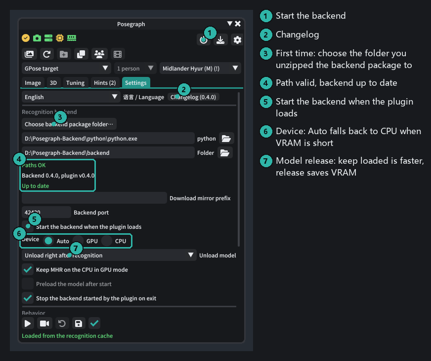
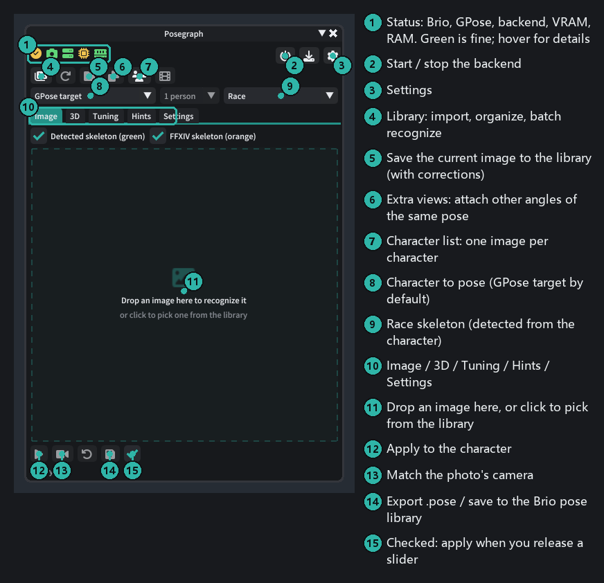
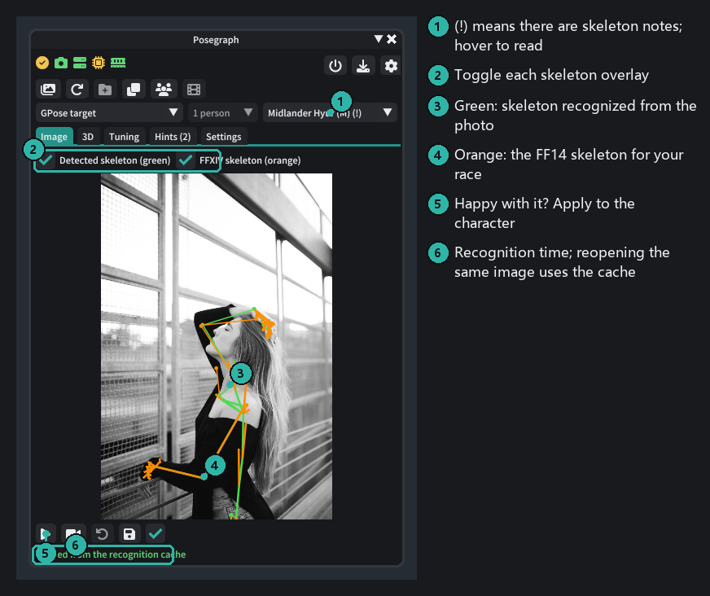
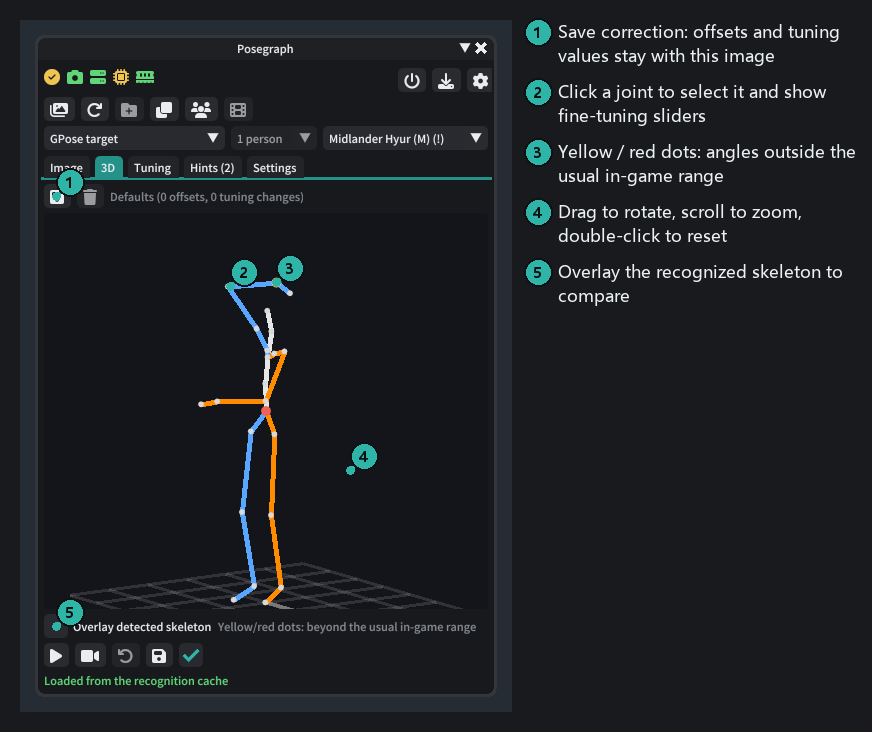
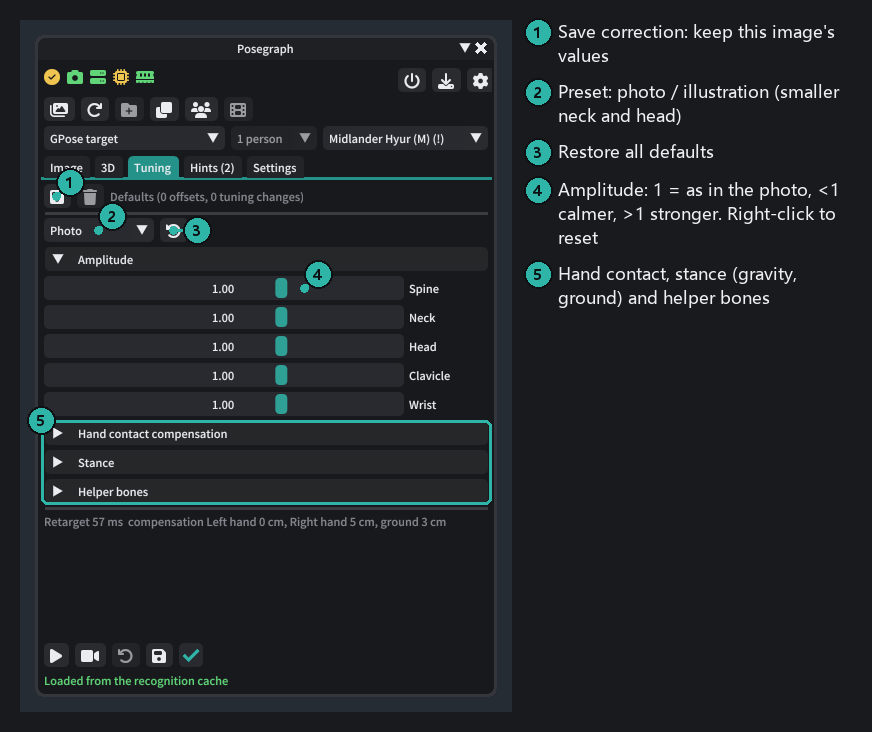
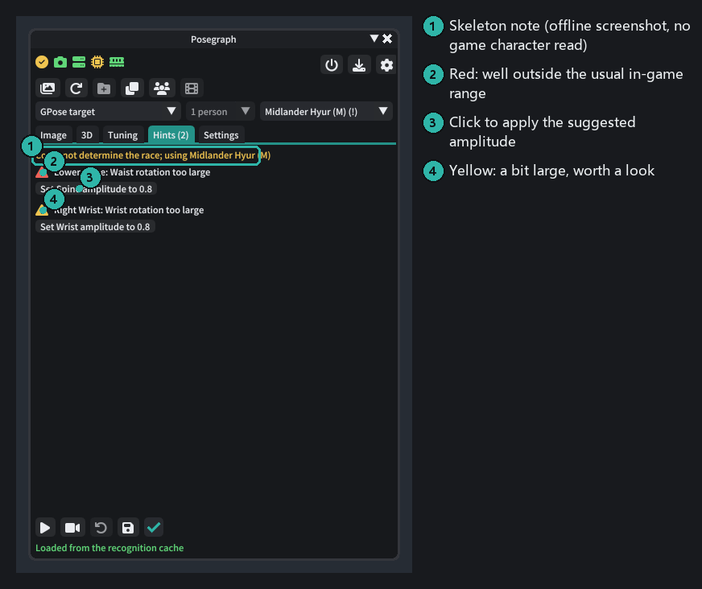
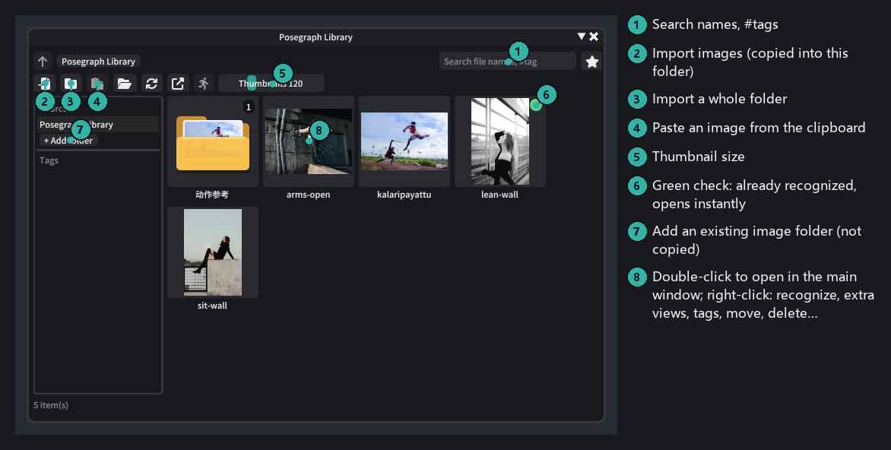
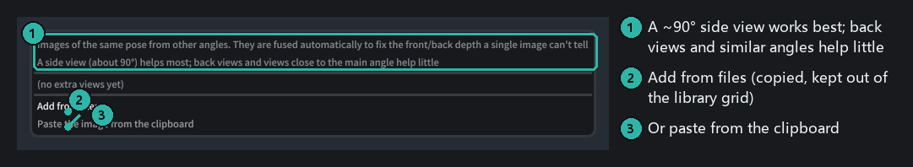
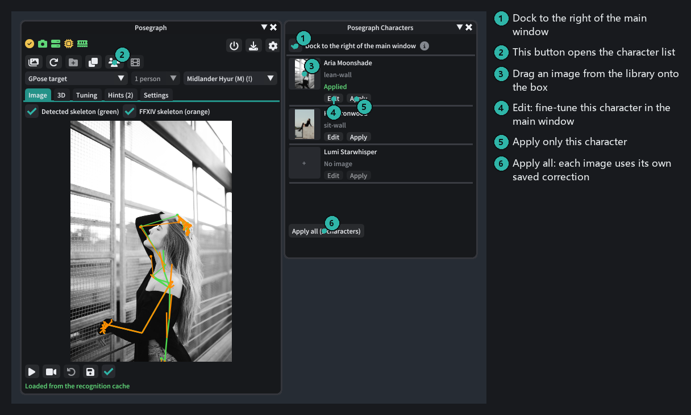
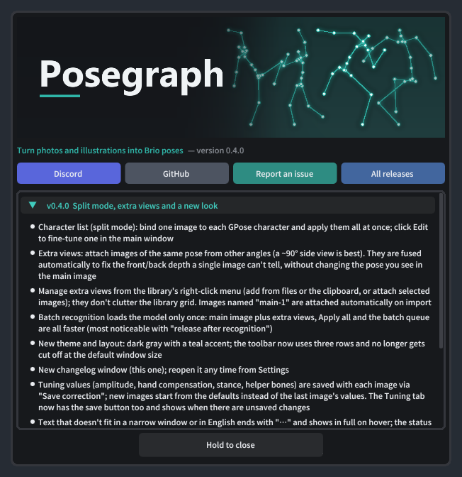

# Posegraph tutorial

**English** | [简体中文](README.zh-CN.md)

This tutorial takes you from installation to putting a photo's pose on your GPose character, then covers the image
library, extra views and posing several characters. The numbers in each screenshot match the notes on its right.
The UI screenshots are made with the [offline screenshot tool](../../tools/UiPreview); the sample photos are credited at the end.

## Contents

1. [Before you start](#1-before-you-start)
2. [Set up the backend](#2-set-up-the-backend)
3. [The main window](#3-the-main-window)
4. [Recognize your first image and apply it](#4-recognize-your-first-image-and-apply-it)
5. [3D tab: check and fine-tune joints](#5-3d-tab-check-and-fine-tune-joints)
6. [Tuning tab: amplitude and corrections](#6-tuning-tab-amplitude-and-corrections)
7. [Hints tab](#7-hints-tab)
8. [Image library](#8-image-library)
9. [Extra views: fixing front/back depth](#9-extra-views-fixing-frontback-depth)
10. [Several characters: the character list](#10-several-characters-the-character-list)
11. [Camera matching, export and restore](#11-camera-matching-export-and-restore)
12. [Updates](#12-updates)
13. [FAQ](#13-faq)

---

## 1. Before you start

You need:

- FFXIV with Dalamud and **[Brio](https://github.com/Etheirys/Brio)** enabled
- The **Posegraph backend package**: [Posegraph-Backend-win64.zip](https://drive.google.com/file/d/1PnbqdyH0hOTMSPhBaSXQ-Dpjp3fil6k2/view?usp=sharing) (about 4 GB).
  Unzip it somewhere with enough space, using an **English-only path** such as `D:\Posegraph-Backend`
- For GPU recognition, an NVIDIA card with about 3 GB of free VRAM; without one it runs on the CPU (about 10–20 s per image)

Install the plugin:

1. In game, type `/xlsettings` → **Experimental** → Custom Plugin Repositories, add
   `https://raw.githubusercontent.com/extrant/DalamudPlugins/main/pluginmaster.json`, tick it and save.
2. Search for **Posegraph** in the plugin installer and install it.
3. Type `/posegraph` to open the main window. The changelog pops up the first time; hold the "Hold to close" button to dismiss it.

## 2. Set up the backend

Go to the main window's **Settings** tab:

1. Click **Choose backend package folder…** and pick the folder you unzipped (it contains `python` and `backend`).
2. "Paths OK" and "Up to date" mean you're set.
3. Click the **power** button at the top right to start the backend. Tick "Start the backend when the plugin loads" so you don't have to every time.
4. Leave the device on **Auto**: it uses the GPU when there is enough VRAM and falls back to the CPU otherwise.

The status icons from left to right are Brio, GPose, IVCS (appears once a character is selected in GPose), backend,
VRAM and RAM. All green means you're ready. Hover over an icon for details.

## 3. The main window

The toolbar has three rows: status and the backend switch; tools (library, save to library, extra views, character list);
and the **character to pose**, the person in the image and the **race skeleton**. The race is detected from the
character's appearance, so you rarely need to change it.

## 4. Recognize your first image and apply it

1. Enter GPose and select the character to pose (or pick one from the dropdown in the third row).
2. Drop an image on the **Image** tab, or click the dashed area to pick one from the library. The first recognition loads
   the model (about 10–20 s); after that it takes a few seconds per image. Recognized images are cached and reopen instantly.
3. Check the overlay: **green** is the skeleton recognized from the photo, **orange** is the FF14 skeleton for your race.
   If they roughly line up, you're good.
4. Click **Apply** (▶) at the bottom left and the pose is on your character.

> **In-game screenshot to come**: the character after applying (suggested file name `images/ingame-apply.png`).

Tips:

- For illustrations choose **Tuning → Preset → Illustration**; it tones down exaggerated head and neck proportions.
- Images dropped on the main window are not added to the library automatically; click "Save to library" in the second row if you want to keep them.

## 5. 3D tab: check and fine-tune joints

- Drag to rotate, scroll to zoom, double-click to reset the view. Looking from the side reveals depth problems you can't see in the photo.
- **Click a joint** to select it; sliders for that joint (manual offsets) appear below.
- Yellow / red dots mark joints whose angles are outside the usual in-game range and may clip.
- When you're happy, click **Save correction** at the top left: the offsets and the Tuning tab's values are stored with this
  image and restored the next time you open it.

## 6. Tuning tab: amplitude and corrections

- **Amplitude**: 1 = as in the photo, below 1 calmer, above 1 stronger. Right-click a slider to reset it.
- **Hand contact compensation**: keeps hands on the head, chest or hips (your race's proportions differ from the person in the photo).
- **Stance**: gravity correction (straightens the body when the photo's camera is tilted) and snapping to the ground.
  **Turn off snapping for jumps and mid-air poses.**
- **Helper bones**: how strongly the skin helpers at elbows, knees, shoulders etc. follow.
- New images start from the defaults; keep this image's values with **Save correction** at the top, which also tells you about unsaved changes.

## 7. Hints tab

Lists joints outside the usual in-game range; red is more serious than yellow. The buttons below apply the suggested amplitude.
(The screenshot was made offline without a game character, which is why it also says the race could not be determined. You won't see that in game.)

## 8. Image library

The first button in the second toolbar row opens the library.

- **Import** images (multi-select), whole folders, the clipboard, or drop files on the library window. Duplicates are detected by content.
- **Add folder** adds an existing image folder as a source (nothing is copied).
- Organize with folders, tags (search `#tag`) and favorites; rename, move, or delete to the Recycle Bin.
- A green check means the image has been recognized; select several and right-click → Recognize to batch them.
- **Double-click** opens an image in the main window; **right-click** has extra views, save to the Brio pose library and more.

## 9. Extra views: fixing front/back depth

The hardest thing to tell from a single photo is depth: is the hand in front of the body or behind it, is the leg raised
forward or to the side? If you have **the same pose from another angle**, attach it as an extra view. The plugin fuses it
automatically and only corrects depth; **the pose you see in the main image stays the same**.

In the library, right-click the main image → **Extra views** (or use the extra views button in the main window's toolbar):

- **Add from files** / **Paste from the clipboard**, or attach other images selected in the library. Extra views don't show up in the library grid.
- Images named "main-1", "main-2" are attached to "main" automatically when imported.
- The menu shows the detected camera angle (left / right / back / almost the same angle) and warns when an image doesn't match the main pose.
- Untick "Use extra views" on the 3D tab to compare.

What makes a good extra view:

| Good | Not helpful |
|---|---|
| A **side view** at about 90° | A back view (same depth axis as the front) |
| Full body, the same pose | Less than 30° from the main image |
| Camera roughly at eye level | Images where an AI changed the pose (you'll get a "doesn't match" warning) |

When generating a side view with AI, ask for "exactly the same pose, the same hands and feet on each side, a 90° side view with the camera at chest height", then check that left and right weren't swapped.

## 10. Several characters: the character list

The "character list" button in the second toolbar row opens this window, docked to the right of the main window.

1. In GPose the list shows every character you can pose.
2. **Drag an image from the library onto the box** to the left of a character, one image per character.
3. Click **Apply all**: each image uses its own saved correction (or the defaults), and extra views are fused automatically.
4. To fine-tune one character, click **Edit**: the main window switches to that character and opens its image. Save the correction on the 3D tab when you're done.

Bindings only last for the current GPose session.

> **In-game screenshot to come**: several characters posed together (suggested file name `images/ingame-split.png`).

## 11. Camera matching, export and restore

Buttons at the bottom of the main window:

- **Match camera** (camera icon): moves the GPose camera to the photo's position, distance and angle. Needs the Posegraph HTTP service (Settings, on by default).
- **Restore** (↶): goes back to the pose before the first apply.
- **Export** (disk icon): export a `.pose` file, or save to the Brio pose library (with preview and tags, ready in Brio's library).

> **In-game screenshot to come**: before/after camera matching (suggested file name `images/ingame-camera.png`).

## 12. Updates

- **Plugin**: updates automatically through the plugin repository. The changelog pops up the first time you open the main window after an update.
- **Backend**: after a plugin update the Settings tab shows the backend version. When it's older, click the download
  button next to it; only the backend code is replaced (under 1 MB) — Python, dependencies and the model stay.
  If GitHub is unreachable, fill in a download mirror prefix.

## 13. FAQ

**Recognition is slow / not enough VRAM**
Keep the device on Auto; with less than 3 GB of VRAM it uses the CPU automatically. CPU recognition takes about 10–20 s
per image, and recognized images are cached. Setting "Unload model" to "Keep loaded" saves the loading time but keeps the VRAM or RAM in use.

**Hands go into the body / don't reach the head**
"Hand contact compensation" on the Tuning tab keeps contact; try a larger "Full effect" distance. Otherwise select the joint on the 3D tab and adjust it by hand.

**A leg or arm points the wrong way front/back**
That's the depth ambiguity of a single photo. A side view as an extra view fixes it best; you can also adjust it on the 3D tab.

**A jump gets pushed to the ground**
Tuning → Stance → turn off "Snap to ground".

**Wrong race**
Pick it manually in the race dropdown at the right of the third toolbar row (happens with race-changing mods or Customize+).

**Fingers are off**
Fingers are more accurate with the IVCS skeleton. Without it the IVCS icon is yellow and the third finger joint's bend is folded into the second.

More questions? Ask on [Discord](https://discord.gg/2z6KdPgacj) or open a [GitHub issue](https://github.com/extrant/Posegraph/issues).

---

### Sample image credits

The sample photos are CC0 (public domain) from Wikimedia Commons, downscaled:

| File | Original |
|---|---|
| `images/sample-lean-wall.jpg` | [Arkansas woman poses (Unsplash)](https://commons.wikimedia.org/wiki/File:Arkansas_woman_poses_(Unsplash).jpg) |
| `images/sample-sit-wall.jpg` | [Smile in Air (Unsplash)](https://commons.wikimedia.org/wiki/File:Smile_in_Air_(Unsplash).jpg) |
| `images/sample-arms-open.jpg` | [Woman posing by drainpipe (Unsplash)](https://commons.wikimedia.org/wiki/File:Woman_posing_by_drainpipe_(Unsplash).jpg) |
| `images/sample-kalaripayattu.jpg` | [Kalaripayattu mock combat in rural Kerala](https://commons.wikimedia.org/wiki/File:Kalaripayattu_mock_combat_in_rural_Kerala.jpg) |
