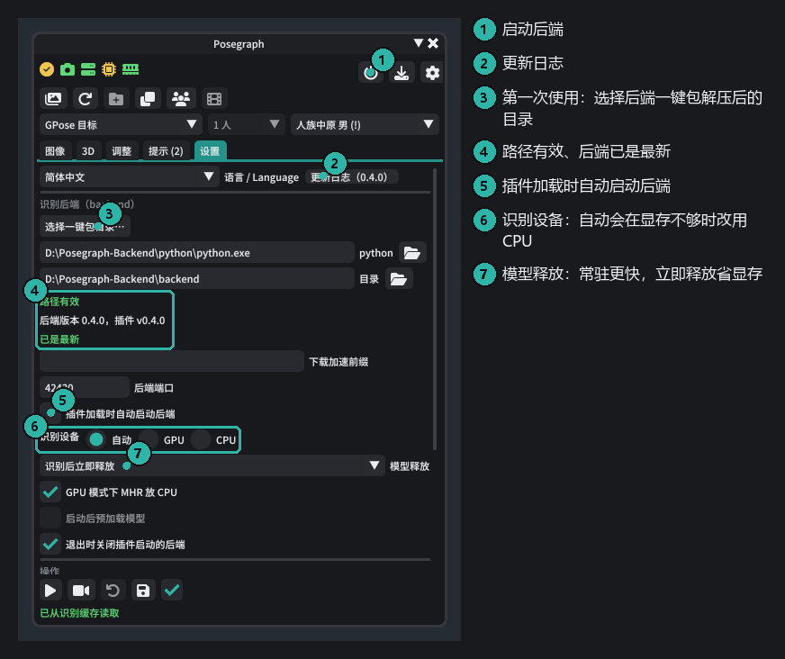
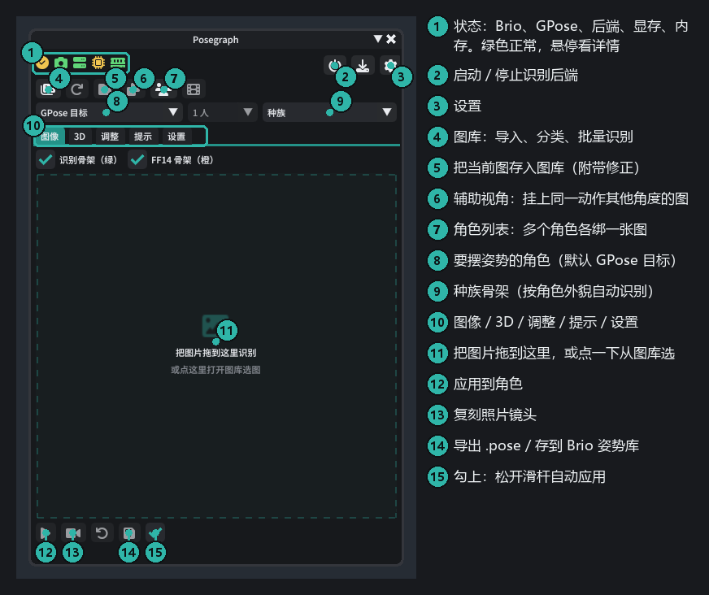
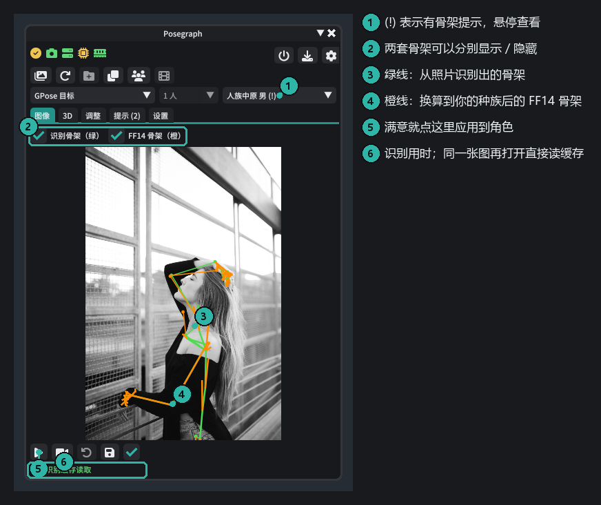
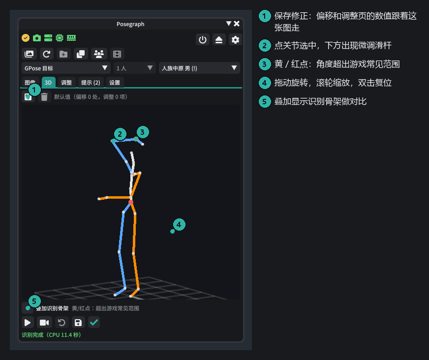
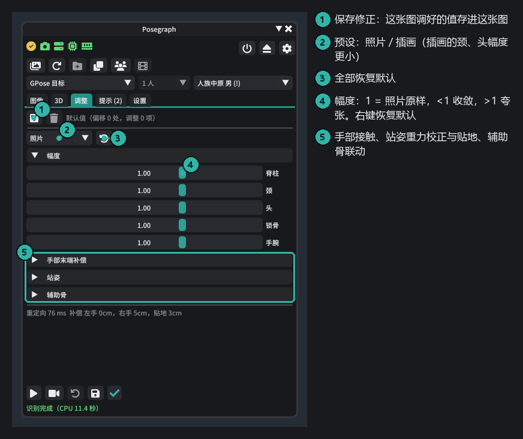
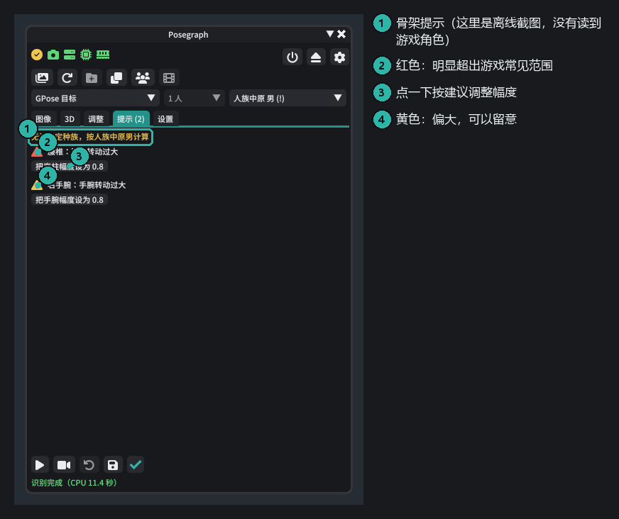
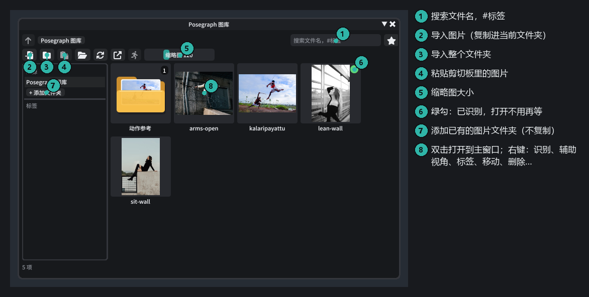
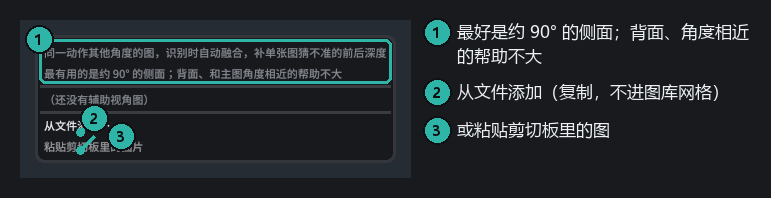
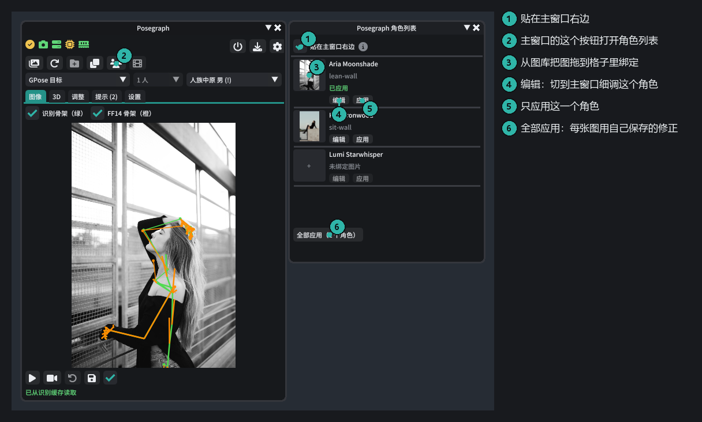
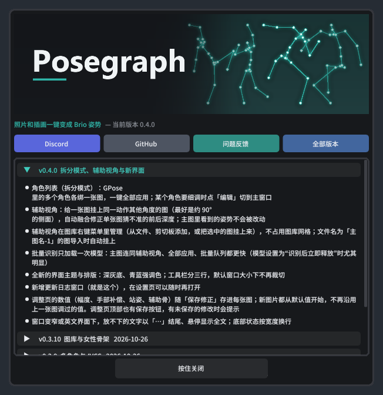

# Posegraph 使用教程

[English](README.md) | **简体中文**

这份教程带你从安装到把一张照片的姿势摆到 GPose 角色身上，再介绍图库、辅助视角和多角色这些进阶功能。
截图里的数字对应右侧的说明。界面截图由 [离线截图工具](../../tools/UiPreview) 生成，示例照片的来源见文末。

## 目录

1. [准备工作](#1-准备工作)
2. [第一次设置后端](#2-第一次设置后端)
3. [认识主窗口](#3-认识主窗口)
4. [识别第一张图并应用](#4-识别第一张图并应用)
5. [3D 页：检查和微调关节](#5-3d-页检查和微调关节)
6. [调整页：幅度与修正](#6-调整页幅度与修正)
7. [提示页](#7-提示页)
8. [图库](#8-图库)
9. [辅助视角：修正前后深度](#9-辅助视角修正前后深度)
10. [多个角色：角色列表](#10-多个角色角色列表)
11. [复刻镜头、导出与还原](#11-复刻镜头导出与还原)
12. [更新](#12-更新)
13. [常见问题](#13-常见问题)

---

## 1. 准备工作

你需要：

- 装好 Dalamud 并启用 **[Brio](https://github.com/Etheirys/Brio)** 的 FF14
- **Posegraph 后端一键包**：[Posegraph-Backend-win64.zip](https://drive.google.com/file/d/1PnbqdyH0hOTMSPhBaSXQ-Dpjp3fil6k2/view?usp=sharing)（约 4GB），
  解压到空间充足的位置，**路径只用英文**，比如 `D:\Posegraph-Backend`
- 用显卡识别要 NVIDIA 显卡、可用显存约 3GB；没有也能用 CPU（每张约 10~20 秒）

安装插件：

1. 游戏里输入 `/xlsettings` → **实验性** → 自定义插件仓库，添加
   `https://raw.githubusercontent.com/extrant/DalamudPlugins/main/pluginmaster.json`，勾选并保存。
2. 插件管理器里搜索 **Posegraph** 并安装。
3. 输入 `/posegraph` 打开主窗口。第一次打开会弹出更新日志，按住「按住关闭」按钮即可关掉。

## 2. 第一次设置后端

切到主窗口的 **设置** 页：

1. 点 **选择一键包目录…**，选你解压出来的文件夹（里面有 `python` 和 `backend`）。
2. 下方显示「路径有效」「已是最新」就对了。
3. 点右上角的 **电源** 按钮启动后端；勾上「插件加载时自动启动后端」以后就不用每次点。
4. 识别设备保持 **自动** 即可：显存够就用显卡，不够自动改用 CPU。

状态栏的图标从左到右是 Brio、GPose、IVCS（在 GPose 里选中角色后才出现）、后端、显存、内存，全绿就可以开始了。鼠标停在图标上能看到详情。

## 3. 认识主窗口

工具栏分三行：第一行是状态和后端开关，第二行是工具（图库、存入图库、辅助视角、角色列表），
第三行选 **要摆姿势的角色**、图里的人物和 **种族骨架**。种族默认按角色外貌自动识别，一般不用改。

## 4. 识别第一张图并应用

1. 进入 GPose，选中要摆姿势的角色（或在第三行的下拉框里选）。
2. 把图片拖到 **图像** 页，或者点那块虚线区域从图库里选。第一次识别要加载模型（约 10~20 秒），之后每张几秒；
   识别过的图会缓存，再打开不用等。
3. 看叠加层：**绿线**是从照片识别出的骨架，**橙线**是换算到你种族后的 FF14 骨架。两条线大致重合就说明没问题。
4. 点左下角的 **应用**（▶），姿势就摆到角色身上了。

> **游戏内效果截图待补**：应用后的角色（建议文件名 `images/ingame-apply.png`）。

小技巧：

- 插画选 **调整 → 预设 → 插画**，会收敛插画里夸张的头颈比例。
- 拖进主窗口的图不会自动存进图库；觉得好用就点第二行的「存入图库」按钮。

## 5. 3D 页：检查和微调关节

- 拖动旋转，滚轮缩放，双击复位视角。从侧面看能发现照片里看不出来的前后深度问题。
- **点一个关节**选中它，下方会出现这个关节的微调滑杆（手动偏移）。
- 黄色 / 红色的点表示这个关节的角度超出游戏动画的常见范围，可能会穿模。
- 调好后点左上角的 **保存修正**：偏移和调整页的数值都存进这张图，下次打开自动恢复。

## 6. 调整页：幅度与修正

- **幅度**：1 = 照片原样，小于 1 动作收敛，大于 1 更夸张。滑杆上点右键恢复默认。
- **手部末端补偿**：手贴着头、胸、髋时保持接触（不同种族的身材比例和照片里的人不一样）。
- **站姿**：重力校正（照片相机歪了时把人扶正）和自动贴地。**跳跃、腾空的图请关掉自动贴地。**
- **辅助骨**：肘、膝、肩等处的蒙皮联动强度。
- 新图片都从默认值开始；这张图调好的值用顶部的 **保存修正** 存下来。顶部会提示有没有未保存的修改。

## 7. 提示页

列出超出游戏常见范围的关节，红色比黄色严重。下面的按钮可以一键按建议调整幅度。
（截图是离线生成的，没有读到游戏里的角色，所以多了一条「无法确定种族」。在游戏里不会出现。）

## 8. 图库

点工具栏第二行第一个按钮打开图库。

- **导入**：多选图片、整个文件夹、剪切板粘贴，或者直接把文件拖进图库窗口。按图片内容查重，不会重复复制。
- **添加文件夹**：把电脑上已有的图片文件夹加为来源（不复制）。
- 用文件夹、标签（搜索 `#标签`）、收藏来分类；可以重命名、移动、删除到回收站。
- 右上角绿色对勾表示已经识别过；选中多张右键「识别」可以批量识别。
- **双击**打开到主窗口；**右键**还有辅助视角、存到 Brio 姿势库等。

## 9. 辅助视角：修正前后深度

单张照片最难判断的是前后深度，比如手是在身前还是身后、腿往前抬还是往侧抬。
如果有**同一个动作从别的角度拍的图**，可以挂上去作为辅助视角，插件会自动融合，只修正深度，
**不会改动主图里看到的姿势**。

在图库里右键主图 → **辅助视角**（主窗口工具栏的辅助视角按钮也行）：

- **从文件添加** / **粘贴剪切板里的图片**，也可以把图库里同时选中的其他图挂上来。辅助图不会出现在图库网格里。
- 文件名为「主图名-1」「主图名-2」的图，导入图库时会自动挂到主图上。
- 菜单里会显示自动判断的机位（左侧 / 右侧 / 背面 / 几乎同角度），和主图动作对不上时会提示。
- 3D 页可以勾掉「使用辅助视角」对比效果。

怎样的辅助图效果最好：

| 推荐 | 不推荐 |
|---|---|
| 约 90° 的**正侧面** | 背面（和正面看到的深度一样，补不了） |
| 全身入画、同一个动作 | 和主图角度相差不到 30° 的图 |
| 机位大致平视 | 动作被 AI 改过的图（会提示「动作对不上」） |

用 AI 生成侧视图时，提示词里写明「严格保持同一姿势、同一侧的手脚、相机在胸口高度的 90° 正侧面」，生成后检查左右手有没有对调。

## 10. 多个角色：角色列表

主窗口第二行的「角色列表」按钮打开这个窗口，默认贴在主窗口右边。

1. 进入 GPose，列表里会列出所有可以摆姿势的角色。
2. 从图库把图**拖到角色左边的格子**里，每个角色绑一张图。
3. 点 **全部应用**：每张图用它自己保存的修正（没有就用默认值），挂了辅助视角的自动融合。
4. 某个角色要细调：点 **编辑**，主窗口会切到这个角色并打开它的图；调好后在 3D 页保存修正。

绑定只在这次 GPose 里有效。

> **游戏内效果截图待补**：多个角色一起摆好姿势（建议文件名 `images/ingame-split.png`）。

## 11. 复刻镜头、导出与还原

主窗口底部的按钮：

- **复刻镜头**（摄像机图标）：把 GPose 相机摆到照片的机位、距离和视角。需要 Posegraph HTTP 服务（设置页，默认开启）。
- **还原**（↶）：回到第一次应用前的姿势。
- **导出**（磁盘图标）：导出 `.pose` 文件，或存到 Brio 姿势库（带预览图和标签，在 Brio 资料库里直接能用）。

> **游戏内效果截图待补**：复刻镜头前后对比（建议文件名 `images/ingame-camera.png`）。

## 12. 更新

- **插件**：通过插件仓库自动更新。更新后第一次打开主窗口会弹出更新日志。
- **后端**：插件更新后，设置页会提示后端版本。后端比插件旧时点旁边的下载按钮，只替换后端代码（不到 1MB），
  Python、依赖和模型都不动。连不上 GitHub 时可以填「下载加速前缀」。

## 13. 常见问题

**识别很慢 / 显存不够**
设置页「识别设备」保持自动；显存不到 3GB 会自动用 CPU。CPU 识别每张约 10~20 秒，识别过的图会缓存。
「模型释放」改成「常驻」能省掉每次加载的时间，但会一直占着显存或内存。

**手穿进身体 / 手没贴到头上**
调整页的「手部末端补偿」负责保持接触，可以调大「完全生效」距离。仍不理想时用 3D 页点选关节手动微调。

**腿或手的前后方向反了**
这是单张照片的深度歧义。挂一张侧面的辅助视角最有效；也可以在 3D 页手动调。

**跳跃的图被按到地上了**
调整页 → 站姿 → 关掉「自动贴地」。

**种族不对**
主窗口第三行最右边的种族下拉框手动指定（换种族 MOD、Customize+ 改体型时会出现）。

**手指不准**
装上 IVCS 骨骼手指会更准；没装时状态栏的 IVCS 图标是黄色，手指第三节的弯曲会合并到第二节。

还有问题欢迎到 [Discord](https://discord.gg/2z6KdPgacj) 或 [GitHub Issues](https://github.com/extrant/Posegraph/issues) 反馈。

---

### 示例图片来源

教程里的示例照片均为 CC0（公共领域），来自 Wikimedia Commons，已缩小：

| 文件 | 原图 |
|---|---|
| `images/sample-lean-wall.jpg` | [Arkansas woman poses (Unsplash)](https://commons.wikimedia.org/wiki/File:Arkansas_woman_poses_(Unsplash).jpg) |
| `images/sample-sit-wall.jpg` | [Smile in Air (Unsplash)](https://commons.wikimedia.org/wiki/File:Smile_in_Air_(Unsplash).jpg) |
| `images/sample-arms-open.jpg` | [Woman posing by drainpipe (Unsplash)](https://commons.wikimedia.org/wiki/File:Woman_posing_by_drainpipe_(Unsplash).jpg) |
| `images/sample-kalaripayattu.jpg` | [Kalaripayattu mock combat in rural Kerala](https://commons.wikimedia.org/wiki/File:Kalaripayattu_mock_combat_in_rural_Kerala.jpg) |
